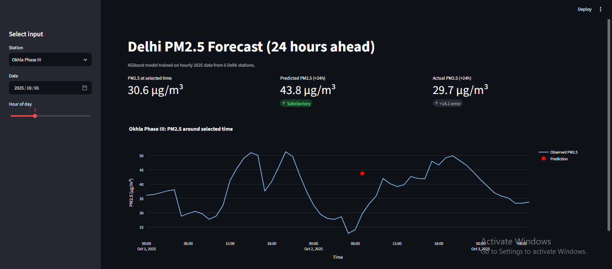
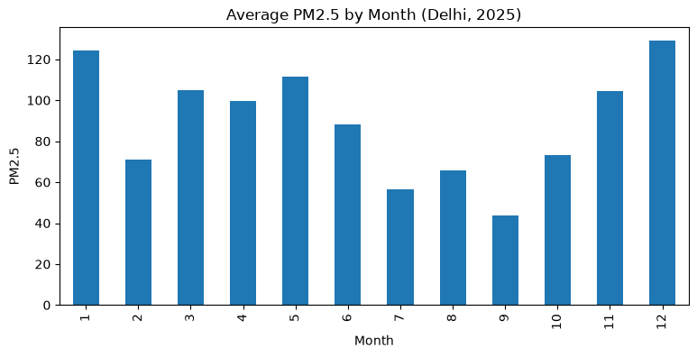

# Delhi PM2.5 Forecast (24 Hours Ahead)

**Live Demo:** <<paste your Streamlit app link here>>

An end-to-end data science project that analyses hourly air pollution data from six Delhi monitoring stations and predicts PM2.5 levels 24 hours ahead using XGBoost. The model is deployed as an interactive Streamlit dashboard.

## Problem Statement

Delhi's air quality deteriorates sharply every winter. This project studies how pollutants and weather conditions relate to PM2.5, identifies seasonal and daily patterns, and builds a model that forecasts PM2.5 for the same hour on the next day.

## Dataset

- **Source:** <<Kaggle dataset link, "delhi-weather-aqi-2025">>
- **Size:** 52,560 rows and 16 columns
- **Coverage:** hourly data from 1 Jan 2025 to 31 Dec 2025
- **Stations (6):** Anand Vihar, Connaught Place, Dwarka, Okhla Phase III, Rohini, IGI Airport (8,760 rows each)
- **Pollutants:** `aqi_index`, `pm2_5`, `pm10`, `co`, `no2`
- **Weather:** `temp_c`, `humidity`, `pressure_mb`, `windspeed_kph`
- **Data quality:** no missing values and no duplicate (station, timestamp) rows

## Methodology

1. **Data preparation:** Combined `date_ist` and `time_ist` into a single `datetime` column and extracted month, hour and day of week.
2. **Outlier handling:** PM10 contained extreme values (maximum 3263.4), so it was capped at its 99th percentile (`pm10_capped`). PM2.5 values were kept, since its maximum (443.3) is realistic for Delhi.
3. **Exploratory analysis:** Monthly trend, station comparison, hour-of-day pattern and a correlation heatmap.
4. **Feature engineering (per station):** PM2.5 lags at 1, 3, 24 and 168 hours, a 24-hour rolling mean, winter and weekend flags, and an encoded station code. Lags were computed separately for each station so values never mix across stations.
5. **Target:** PM2.5 24 hours ahead (`shift(-24)`).
6. **Train-test split:** Chronological. Training uses data before 1 Oct 2025 (minus a 24-hour gap to avoid leakage). Testing uses Oct-Dec 2025, which includes Diwali and the start of winter.
7. **Modelling:** A naive baseline (same value as 24 hours ago), Linear Regression, Random Forest and XGBoost.
8. **Deployment:** Streamlit app on Streamlit Community Cloud.

### Features used (19)

`pm2_5`, `pm25_lag1`, `pm25_lag3`, `pm25_lag24`, `pm25_lag168`, `pm25_roll24`, `pm10_capped`, `no2`, `co`, `temp_c`, `humidity`, `pressure_mb`, `windspeed_kph`, `hour`, `month`, `dayofweek`, `is_winter`, `is_weekend`, `location_code`

### Model settings

| Model | Key parameters |
|-------|----------------|
| Random Forest | 200 trees, max depth 12, min samples per leaf 5 |
| XGBoost | 400 trees, learning rate 0.05, max depth 6, subsample 0.8, colsample 0.8 |

## Results

Evaluated on the test period (Oct-Dec 2025).

| Model | RMSE | MAE | R² |
|-------|------|-----|----|
| Baseline (same as 24h ago) | <<value>> | <<value>> | <<value>> |
| Linear Regression | <<value>> | <<value>> | <<value>> |
| Random Forest | <<value>> | <<value>> | <<value>> |
| XGBoost | <<value>> | <<value>> | <<value>> |

**Best model:** <<model name>>, which improves RMSE over the baseline by <<X>>%.

## Key Insights

- <<Which months had the highest PM2.5, from the monthly chart>>
- <<Which station was most polluted, from the station chart>>
- <<Which hours of the day peak, from the hourly chart>>
- <<Top 3 features from the XGBoost feature importance>>

## Screenshots




## Dashboard

The app lets you pick a station, date and hour (within the test period). It shows the PM2.5 at that time, the model's prediction for 24 hours later, the actual value, the prediction error, and a chart of observed PM2.5 around the selected time.

## Limitations

- The dataset covers only one year (2025), so the model has not seen other years or seasons' variation across years.
- Several stations show identical values at the same timestamps, which suggests the data may come from a grid-based source rather than independent sensors. The six stations therefore do not give six times the information, and scores may look better than real-world performance.
- `aqi_index` and PM10 contain extreme, inconsistent values, so PM2.5 was used as the target and PM10 was capped.
- Hyperparameters were not tuned on a separate validation set.

## Tech Stack

Python, Pandas, NumPy, Scikit-learn, XGBoost, Matplotlib, Seaborn, Plotly, Streamlit

## Project Structure

```
delhi-aqi-prediction/
├── data/
│   └── app_data.csv        # Test-period data used by the app
├── notebooks/              # EDA, feature engineering and modelling
├── images/                 # Screenshots and charts
├── app.py                  # Streamlit application
├── model.pkl               # Trained XGBoost model
├── features.pkl            # Feature list (column order)
├── requirements.txt
├── .gitignore
└── README.md
```

The original dataset (CSV) is not included in the repository because of its size. Download it from the link above and place it in `data/archive/`.

## Run Locally

```bash
git clone https://github.com/<<YOUR-USERNAME>>/delhi-aqi-prediction.git
cd delhi-aqi-prediction
python -m venv venv
venv\Scripts\activate
pip install -r requirements.txt
streamlit run app.py
```

## Future Improvements

- Train on multiple years of data
- Add multi-horizon forecasts (6, 12, 48 hours)
- Pull live data through an API
- Tune hyperparameters with time-series cross-validation

## Author

**Nipun Kumar**
[LinkedIn]Nipun Kumar(https://www.linkedin.com/in/nipun-kumar-6827b737a) | [GitHub]nipunkumar2020-maker(https://github.com/nipunkumar2020-maker)